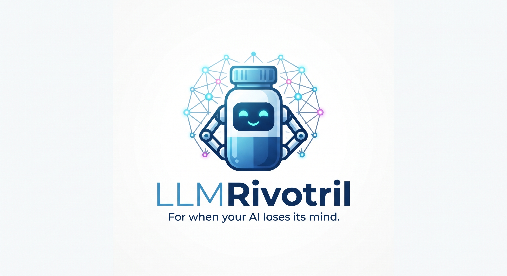

# LLM-Rivotril



[](https://pypi.org/project/llmrivotril/)
[](https://pypi.org/project/llmrivotril/)

*[Português](https://github.com/ailake-io/llmrivotril/blob/main/README.pt-BR.md)*

A lightweight Python framework to reduce LLM hallucinations, enforce guardrails, manage stateful memory, and monitor performance through a local web dashboard.

## Why LLM-Rivotril?

LLM-Rivotril is an orchestration and safety layer around an LLM; it is not a
model and does not make a small model inherently smarter. It lets the same
application move between local and hosted models while keeping a consistent
interface for guardrails, memory, caching, retries, streaming, tool calling,
telemetry, and framework integrations.

Use Ollama when privacy, offline operation, and predictable local costs matter;
use a hosted provider when you need a larger or more capable model. In both
cases, LLM-Rivotril keeps the application-level controls in one place.

## Features

- **Guardrails** — Block disallowed keywords, enforce allowed topics, limit output size, and validate JSON schemas on outputs.
- **Semantic Guardrails** *(optional)* — Match prompts against allowed topics using dense embeddings instead of exact keywords.
- **Moderation Guardrail** — Flag adversarial/unsafe content via OpenAI's moderation endpoint.
- **Stateful Memory** — Sliding-window conversation store to prevent context drift, with optional automatic disk persistence.
- **Anti-Hallucination Verifier** — Pluggable grounding checks, including keyword overlap, citation markers, and embedding-based faithfulness.
- **Resilience** — Built-in rate limiting, retry with backoff, and circuit breaker for LLM calls.
- **Token-Saving Controls** *(optional)* — Semantic (similarity-based) response cache, token-budget-aware memory trimming, and LLM-summarized history compaction.
- **Telemetry & Dashboard** — Built-in FastAPI dashboard with live request logs, token usage, latency, and success rate; optional per-token auth.
- **Benchmark / Red-Team Evaluator** — Labeled suite to measure guardrail and verifier accuracy without API costs.
- **CLI** — Launch the dashboard with a single command.
- **Type-Safe Responses** — Optional Pydantic response models via `instructor`, including streamed structured output.
- **Async API** — `run_async()` for non-blocking execution.
- **Multi-Provider** — OpenAI-compatible servers (Ollama, vLLM, ...), plus native Anthropic, Cohere, Gemini, Azure OpenAI, and AWS Bedrock adapters.
- **Vector-Store Retrievers** *(optional)* — pgvector, Qdrant, Weaviate, and Pinecone adapters for RAG beyond in-memory scale.
- **Framework Integrations** *(optional)* — Drop-in adapters for CrewAI, AG2/AutoGen, LangChain/LangGraph, and Google ADK, so guardrails/PII/RAG/observability apply inside those frameworks too.

## Installation

```bash
pip install llmrivotril
```

For semantic (embedding-based) guardrails and verifiers:

```bash
pip install llmrivotril[semantic]
```

For local development:

```bash
git clone https://github.com/ailake-io/llmrivotril.git
cd llmrivotril
pip install -e ".[dev,semantic]"
```

This installs test, lint, type-check, and packaging tools (`pytest`, `ruff`, `mypy`, `build`, `twine`) plus every optional runtime dependency (all providers, RAG loaders, vector stores, Redis, framework integrations).

## Quick Start

```python
import os
from llmrivotril import RivotrilAgent, Guardrail
from llmrivotril.verifier import KeywordOverlapVerifier

agent = RivotrilAgent(
    model="gpt-4o-mini",
    api_key=os.getenv("OPENAI_API_KEY"),
    guardrails=[
        Guardrail(
            name="safe-content",
            allowed_topics=["AI safety", "machine learning"],
            disallowed_keywords=["password", "secret"],
            max_tokens=500,
        )
    ],
    verifier=KeywordOverlapVerifier(threshold=0.1),
)

response = agent.run("Explain what a guardrail is in AI safety.")
print(response)
```

### Local Ollama

With Ollama running locally, use its OpenAI-compatible endpoint. The API key
is only a placeholder required by the OpenAI client and is not sent to a
remote provider:

```bash
ollama serve
ollama pull qwen2.5:3b
```

```python
from llmrivotril import RivotrilAgent

agent = RivotrilAgent(
    model="qwen2.5:3b",
    base_url="http://127.0.0.1:11434/v1",
    api_key="ollama",
)
print(agent.run("Explain what a guardrail is in AI safety."))
```

The model quality, latency, and hardware requirements depend on the Ollama
model selected. Keep Ollama bound to localhost when prompts must stay on the
machine.

## Documentation

- [Providers](https://github.com/ailake-io/llmrivotril/blob/main/docs/providers.md) — OpenAI-compatible servers, Anthropic, Cohere, Gemini, Azure OpenAI, AWS Bedrock.
- [Guardrails & Safety](https://github.com/ailake-io/llmrivotril/blob/main/docs/guardrails-and-safety.md) — Semantic guardrails, moderation, PII redaction, token budget.
- [RAG](https://github.com/ailake-io/llmrivotril/blob/main/docs/rag.md) — Local pipeline, vector-store retrievers (pgvector/Qdrant/Weaviate/Pinecone), grounding verification.
- [Framework Integrations](https://github.com/ailake-io/llmrivotril/blob/main/docs/integrations.md) — CrewAI, AG2/AutoGen, LangChain/LangGraph, Google ADK adapters, and multi-agent setup notes.
- [Async, Streaming & Function Calling](https://github.com/ailake-io/llmrivotril/blob/main/docs/streaming-and-tools.md)
- [Reliability](https://github.com/ailake-io/llmrivotril/blob/main/docs/reliability.md) — Resilience, response caching (including semantic cache), memory token budget & summarization, schema-repair fallback.
- [Observability](https://github.com/ailake-io/llmrivotril/blob/main/docs/observability.md) — Metrics persistence, local dashboard, benchmark, cost tracking.
- [Configuration](https://github.com/ailake-io/llmrivotril/blob/main/docs/configuration.md) — Config files, environment variables, plugins, project scaffolding.
- [Releasing](https://github.com/ailake-io/llmrivotril/blob/main/docs/releasing.md) — Build validation, TestPyPI, and the PyPI release workflow.

## Interactive Demo

Run a complete walkthrough with mock LLM responses (no API key, no cost):

```bash
python examples/demo.py --mock --dashboard
```

Then open http://127.0.0.1:8767 to watch the dashboard update live.

## Comparison: With vs. Without `llmrivotril`

See the same scenarios side-by-side:

```bash
python examples/comparison.py --mock
```

The comparison highlights how plain LLM calls return harmful or hallucinated
answers that are only caught manually afterwards, while `llmrivotril` blocks
them at runtime and records structured telemetry.

## Project Structure

```
llmrivotril/
├── src/llmrivotril/
│   ├── agent.py              # RivotrilAgent orchestrator (sync + async)
│   ├── config.py             # Environment-variable and file configuration loader
│   ├── guardrails.py         # Input/output guardrails
│   ├── moderation.py         # OpenAI moderation-endpoint guardrail
│   ├── memory.py             # Conversation memory store
│   ├── verifier.py           # Hallucination / grounding checks
│   ├── providers.py          # OpenAI / Azure / Anthropic / Cohere / Gemini / Bedrock adapters
│   ├── rag/                  # RAG loaders, chunkers, retrievers, vector stores, and pipeline
│   ├── integrations/         # CrewAI / AG2 / LangChain / Google ADK adapters
│   ├── resilience.py         # Rate limiter, retry, and circuit breaker
│   ├── semantic.py           # Optional embedding-based guardrails/verifiers
│   ├── metrics.py            # Telemetry collector
│   ├── server.py             # FastAPI dashboard
│   ├── cli.py                # Click CLI
│   ├── exceptions.py         # Custom exceptions
│   ├── templates/
│   │   └── dashboard.html    # Dashboard UI template
│   └── static/
│       └── tailwind.min.js   # Bundled Tailwind CSS for offline dashboard
├── tests/
├── examples/
└── docs/
```

## Development

Run lint, type checks, and tests:

```bash
pip install -e ".[dev,semantic]"
ruff check src tests examples scripts
ruff format --check src tests examples scripts
mypy src
pytest -v
```

Slow integration tests (e.g. loading `sentence-transformers` models) are skipped by
default. Run them with:

```bash
pytest -v --run-slow
```

For a reproducible provider/integration environment, apply the versions validated
locally before installing the desired extras:

```bash
python -m pip install -c .github/constraints-runtime.txt \
  -e ".[integrations,providers,semantic,qdrant]"
```

## CI/CD


The GitHub Actions workflow runs linting, type checking, tests, and package builds on Python 3.10–3.15.

Set `max_output_tokens` for a native per-generation output budget, including
follow-ups and summaries. This is not a cumulative spending cap.
For supported text-only OpenAI/Azure sessions, `max_session_cost_usd` plus
explicit input/output prices enables an estimated session cost limit using
atomic local reservations. See
[reservation limits and accounting](docs/reliability.md); provider billing can
still differ from local estimates. `provider_usage` tracks additional calls.
AG2 supports function-tool events, structured validation and text streaming
(AG2 1.3+, Python 3.11+). See [integrations](docs/integrations.md).
Run [local comparisons](docs/local-benchmark.md) without a model account.
Optional [Jev checks and context selection](docs/guardrails-and-safety.md#jev-triage-guardrail)
are available through `llmrivotril[jev]`. They use TypeSafe by default or a
local System One-compatible server such as
[`local-jev`](https://github.com/amithgc/local-jev) with `base_url=`; local
inference has no per-call provider charge. Ollama 0.35+ also supports this API;
see the [local setup](docs/guardrails-and-safety.md#jev-triage-guardrail).
Input guardrails can run in a bounded pool with `parallel_guardrails=True`.
Set `max_concurrent_calls` to bound provider concurrency per agent. Explicitly
close streams when stopping early; see [reliability](docs/reliability.md).

Offline SDK contracts: `pytest -q tests/test_http_contracts.py` uses in-memory
HTTP with dummy credentials. For telemetry without request or error content,
pass `MetricsCollector(include_content=False)` to the agent. See
[observability](docs/observability.md).

Optional size controls: `max_context_chars`, `max_attachment_bytes`, and `max_response_chars` accept positive integers (default `None`). Response checks run locally and do not cap provider billing. See [configuration](docs/configuration.md) for streaming and attachment semantics.

## License

MIT License — see [LICENSE](https://github.com/ailake-io/llmrivotril/blob/main/LICENSE).
